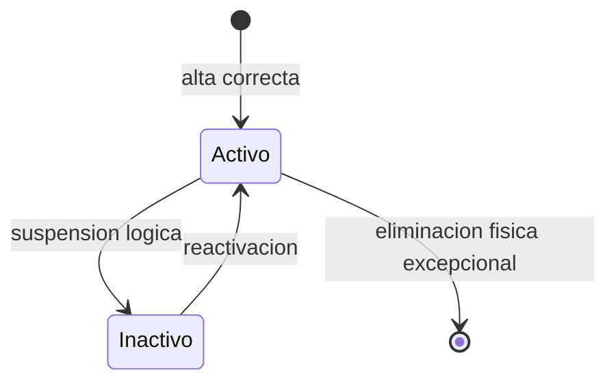
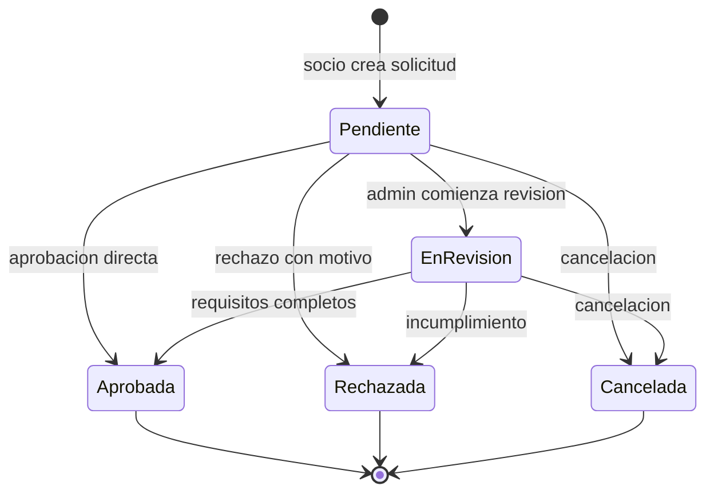
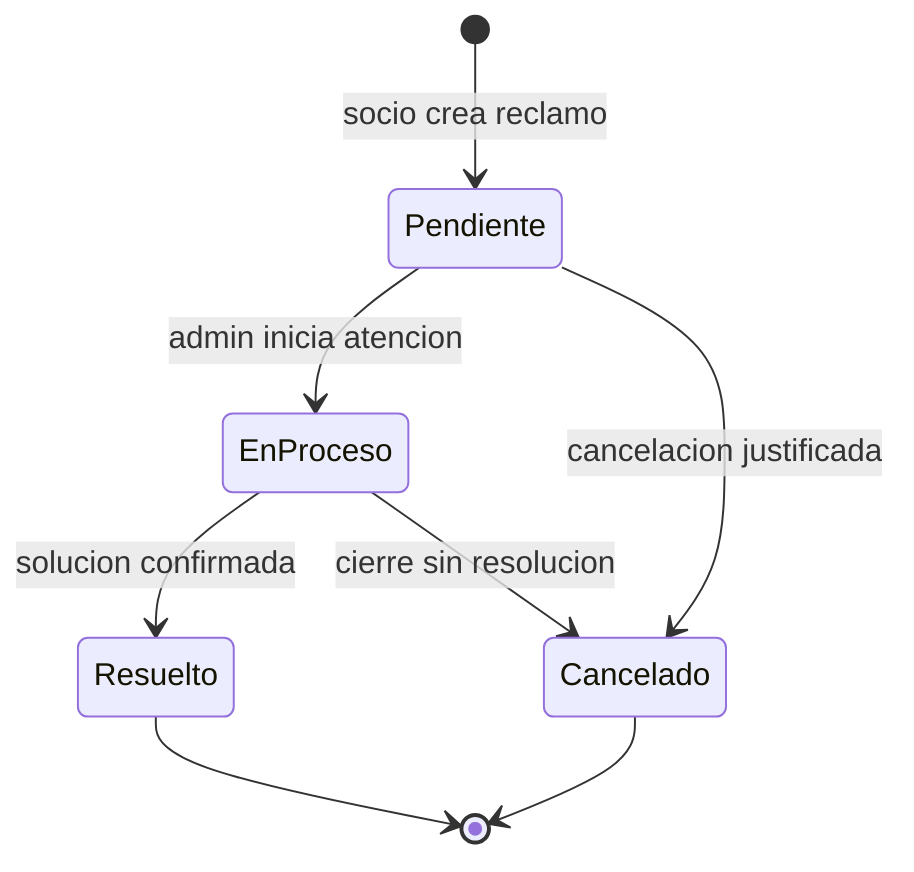
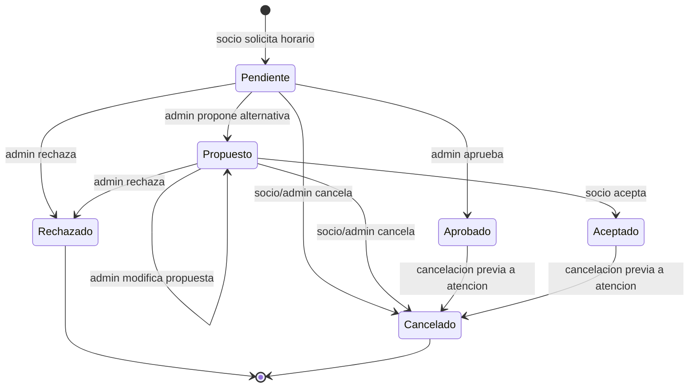
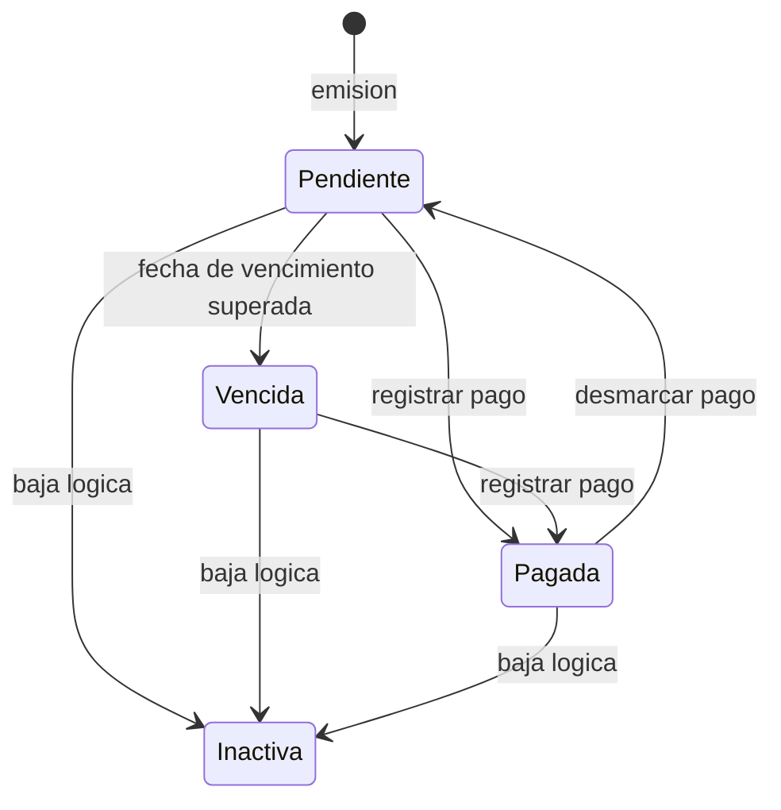
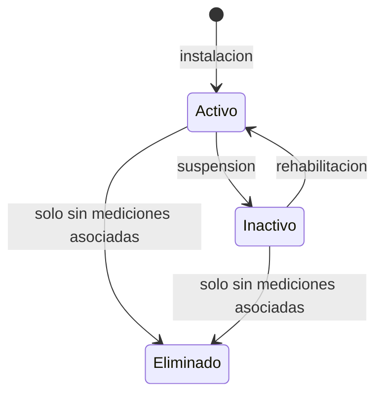
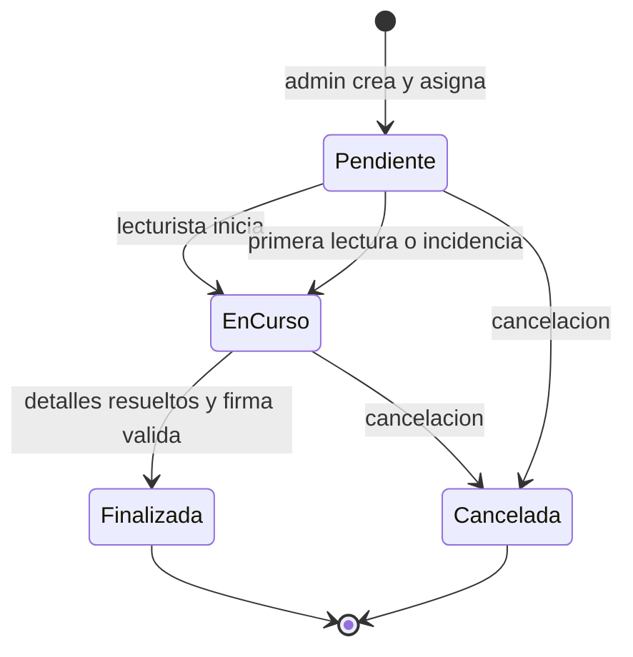
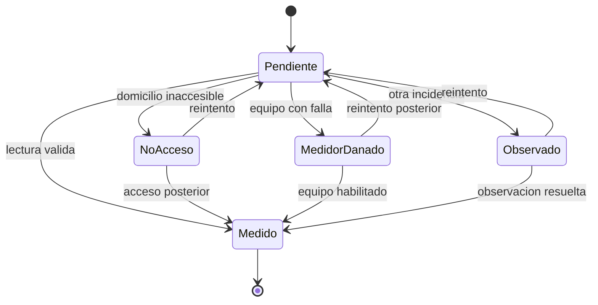
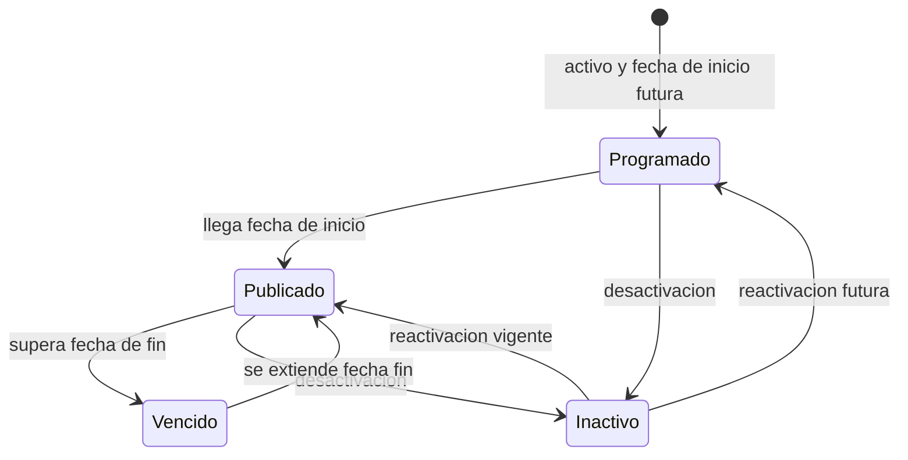

# 2. Diagramas de estado

## 2.1 Socio y empleado

Reglas verificadas:

- El login rechaza empleados inactivos.
- Los listados administrativos muestran activos e inactivos.
- La suspension no deberia borrar datos relacionados.

Riesgo:

- Existe un endpoint de eliminacion de socio ademas del cambio de estado. Para produccion debe reservarse para casos controlados o eliminarse.

## 2.2 Solicitud de servicio

Efectos de aprobar verificados:

- Se crea o reactiva la asignacion `ServicioSocio`.
- Para el servicio Luz se intenta crear un medidor.
- Se guarda fecha de resolucion.

Brecha:

- La API actual permite llamar aprobar o rechazar sin comprobar el estado anterior. El diagrama representa el flujo funcional esperado, no una restriccion totalmente aplicada.

## 2.3 Reclamo

Brecha:

- La API verifica que el estado exista, pero no limita la transicion segun el estado actual.
- La baja logica `Activo = false` es independiente del estado funcional.

## 2.4 Turno

Reglas verificadas:

- Solo dias habiles.
- Solo horarios permitidos.
- No se aceptan fechas u horas pasadas.
- Se usa transaccion y bloqueo para evitar doble reserva.
- La propuesta solo puede aceptarse si existe y sigue disponible.

Brecha:

- El endpoint administrativo resuelve cualquier ID de estado entre 1 y 6 y no implementa una matriz completa de transiciones.

## 2.5 Factura

Observaciones:

- `Vencida` es calculado, no persistido.
- La API permite desmarcar una factura pagada. Esto requiere decision del cliente porque afecta trazabilidad contable.
- No existe entidad Pago real asociada a la factura.

## 2.6 Medidor

Reglas verificadas:

- No se crea para una asignacion inexistente.
- Requiere tipo de medidor valido.
- No se elimina si tiene mediciones.
- Una medicion no se registra sobre un medidor inactivo.

## 2.7 Ruta de medicion

Reglas verificadas:

- Una ruta cerrada no acepta lecturas.
- Solo el empleado asignado puede informar una lectura.
- Un medidor solo aparece una vez en una ruta.
- No puede asignarse si ya esta en una ruta pendiente o en curso.
- No se finaliza con detalles pendientes.
- La firma digital base64 es obligatoria.

## 2.8 Detalle de ruta

Regla:

- Una medicion registrada no puede volver a otro estado desde la API actual.

## 2.9 Anuncio

Notas:

- Programado, Publicado y Vencido son estados derivados de `Activo`, `FechaInicio` y `FechaFin`.
- La prioridad esta normalizada en `PrioridadAnuncio`.

