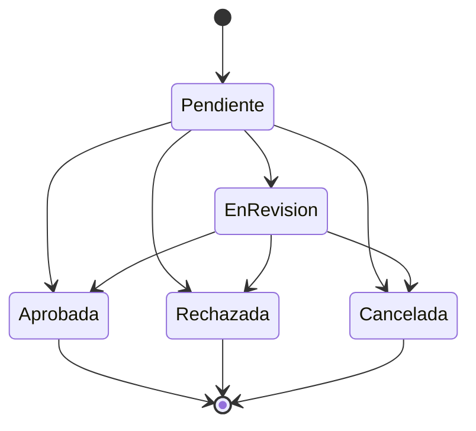
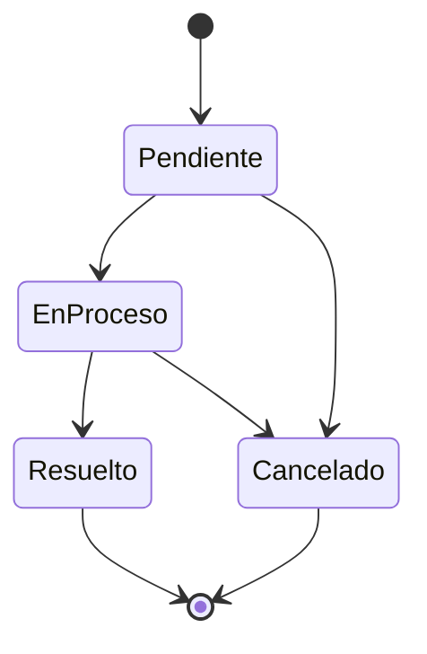
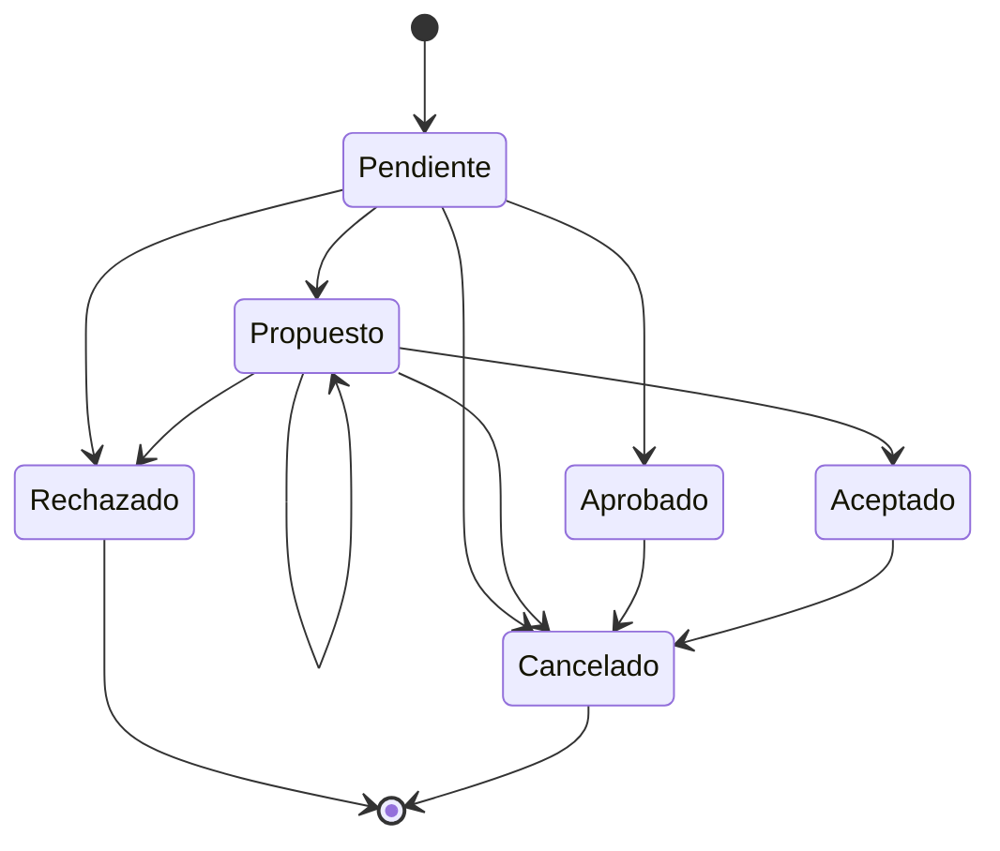
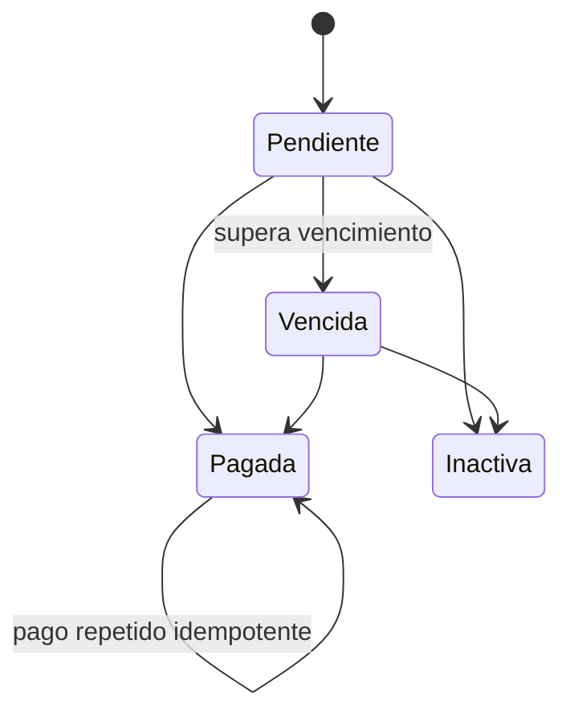
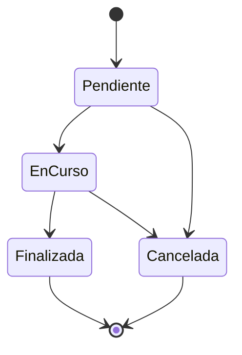
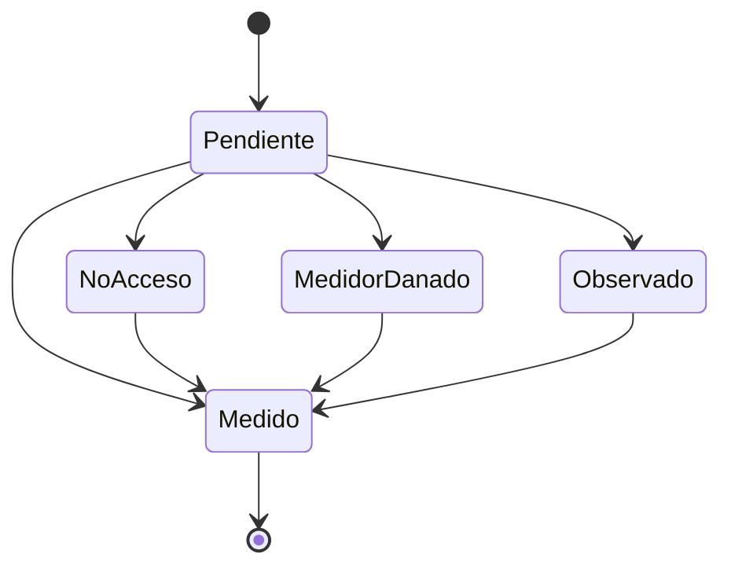

# Cooperativa de Agua y Luz

## Encuentro 6: Casos borde

**Pregunta eje:** ¿Qué pasa cuando algo sale mal?

**Fecha de cierre técnico:** 17 de junio de 2026  
**Integrantes:** completar antes de entregar  
**Cooperativa / cliente:** completar antes de entregar

---

## 1. Resumen ejecutivo

El sistema fue revisado desde el frontend React, la API ASP.NET Web API, las reglas de negocio, los estados persistidos y los mensajes que recibe el usuario.

La conclusión es que los flujos operativos principales cuentan con controles reales para impedir datos inválidos y transiciones incoherentes. La revisión confirmó reglas de autorización, propiedad, estados, validación de datos y manejo de errores en autenticación, solicitudes, reclamos, turnos, facturas, medidores, mediciones, rutas, anuncios, socios y empleados.

Durante esta auditoría se corrigió un problema concreto: la administración de reclamos podía mostrar un cambio de estado solo en la interfaz aunque la API no lo hubiera guardado. Ahora:

- Se usa el endpoint real `PUT api/reclamo/{id}`.
- La vista no se modifica cuando la API rechaza la operación.
- El usuario recibe el mensaje de error.
- Solo se ofrecen transiciones permitidas.
- Los cuatro estados de reclamo están contemplados.
- La regla quedó cubierta por pruebas automatizadas.

### Resultado de verificación

| Verificación | Resultado |
| --- | --- |
| Pruebas automatizadas frontend | 13 de 13 correctas |
| Build frontend de producción | Correcto |
| Build API ASP.NET Debug / Any CPU | Correcto |
| Advertencias o errores de compilación API | 0 advertencias, 0 errores |
| Revisión estática de controladores y pantallas | Realizada |
| Pruebas integrales con API y base ejecutándose | Pendientes de evidencia manual |
| Validación formal con el cliente | Pendiente |

### Clasificación usada

| Estado | Significado |
| --- | --- |
| Verificado | Regla observada en código y/o cubierta por prueba automática |
| Corregido | Se detectó una falla y se modificó la implementación |
| Parcial | Existe control, pero falta uniformidad o prueba integrada |
| Pendiente | No puede afirmarse como probado |
| Cliente | Requiere una decisión funcional de la cooperativa |

---

## 2. Alcance funcional auditado

| Módulo | Flujos revisados | Resultado |
| --- | --- | --- |
| Autenticación | Login, sesión, expiración, roles, inactividad, cambio y recuperación de clave | Verificado |
| Socios | Alta, edición, consulta, activación y suspensión | Verificado |
| Empleados | Alta, edición, cargos, activación y suspensión | Verificado |
| Servicios | ABM, asignación y baja lógica | Verificado |
| Solicitudes | Alta, duplicados, documentos, aprobación y rechazo | Verificado |
| Reclamos | Alta, listado y transiciones | Corregido y verificado |
| Turnos | Disponibilidad, reserva, propuesta, aceptación y cancelación | Verificado |
| Facturas | Alta, edición, pago, vencimiento y baja | Verificado |
| Pagos | Visualización de facturas pagadas | Parcial; no existe transacción bancaria real |
| Medidores | Alta, asignación, estado y eliminación condicionada | Verificado |
| Mediciones | Lectura, monotonicidad y relación con medidor | Verificado |
| Rutas | Alta, asignación, ejecución, incidencias, firma y cierre | Verificado |
| Anuncios | Alta, vigencia, prioridad, edición y baja lógica | Verificado |
| Reportes | Indicadores y exportación CSV | Verificado en frontend |

### Roles

- Visitante: inicio, anuncios públicos, ayuda, registro y login.
- Socio: perfil, servicios, solicitudes, reclamos, facturas, mediciones y turnos.
- Empleado: panel y funciones habilitadas según cargo.
- Lecturista: hoja de ruta, lecturas, incidencias y cierre firmado.
- Técnico: solicitudes técnicas.
- Administrador: gestión integral del sistema.

---

## 3. Diagramas y reglas de estado

### 3.1 Solicitud de servicio

Reglas verificadas:

- El socio autenticado es tomado del token, no del cuerpo enviado.
- No se permite crear otra solicitud abierta para el mismo socio y servicio.
- Solo una solicitud Pendiente o En Revisión puede aprobarse o rechazarse.
- El rechazo exige motivo y limita su longitud.
- La aprobación crea o reutiliza `ServicioSocio`.
- Si el servicio es Luz, se crea un medidor cuando corresponde.
- La aprobación se ejecuta dentro de una transacción.

### 3.2 Reclamo

Reglas verificadas:

- Solo un socio autenticado puede crear su reclamo.
- El socio debe estar activo.
- La descripción es obligatoria.
- El tipo y el estado deben existir.
- El backend aplica una matriz de transiciones.
- La interfaz administrativa aplica la misma matriz.
- Un error de API no produce un falso éxito local.

### 3.3 Turno

Reglas verificadas:

- No se aceptan fechas pasadas, fines de semana ni horarios fuera de agenda.
- El socio solo opera sus propios turnos.
- Los estados que ocupan horario evitan una doble reserva.
- La concurrencia devuelve conflicto cuando otro usuario tomó el horario.
- Una propuesta solo puede aceptarse desde Propuesto.
- La administración aplica una matriz de transición.
- Cancelar nuevamente un turno cancelado es idempotente.
- Un turno rechazado no puede cancelarse.

### 3.4 Factura

Reglas verificadas:

- El monto debe ser mayor que cero.
- El vencimiento no puede ser anterior a la emisión.
- El link de pago, si existe, debe ser HTTP o HTTPS.
- El servicio debe estar activo para el socio.
- Una factura pagada no puede volver a pendiente.
- Pagar nuevamente no duplica la operación.
- Una factura pagada no puede darse de baja.
- Vencida es un estado calculado.

Limitación:

- No existe una entidad Pago con referencia bancaria, medio, conciliación o comprobante.

### 3.5 Ruta de medición

Detalle:

Reglas verificadas:

- La ruta requiere lecturista y al menos un medidor.
- Solo admite medidores activos y no repetidos.
- Un medidor no puede estar en dos rutas abiertas.
- Solo el empleado asignado puede operar la ruta.
- No se registra una lectura menor a la anterior.
- Un detalle medido no puede medirse nuevamente.
- No se finaliza con detalles pendientes.
- La firma es obligatoria y debe tener formato válido.
- Una ruta finalizada o cancelada no admite cambios operativos.
- Si la API no está disponible, el frontend no simula éxito.

### 3.6 Estados binarios o derivados

| Entidad | Estados |
| --- | --- |
| Socio | Activo / Inactivo |
| Empleado | Activo / Inactivo |
| ServicioSocio | Activo / Inactivo |
| Medidor | Activo / Inactivo |
| Requisito | Activo / Inactivo |
| Anuncio | Activo / Inactivo; su vigencia se deriva de fechas |
| Factura | Activa / Inactiva; Pendiente, Vencida o Pagada se calcula |

---

## 4. Validaciones de datos

### Frontend

- Correo con usuario, arroba y dominio.
- Documento de 7 a 9 dígitos.
- Nombre y apellido con letras Unicode, espacios, apóstrofe o guion.
- Teléfono de 7 a 20 caracteres permitidos.
- Domicilio y número con formato controlado.
- Contraseña con 8 caracteres como mínimo, mayúscula, minúscula, número y símbolo.
- Campos obligatorios.
- Limpieza de espacios repetidos.
- Números positivos o no negativos según el campo.
- Fechas válidas y fechas futuras cuando corresponde.
- Límites de longitud.
- Archivos y formularios con mensajes funcionales.

### Backend

- El token determina identidad, rol y propiedad.
- Recursos ajenos devuelven prohibición.
- Estados inexistentes o transiciones inválidas se rechazan.
- Referencias a socio, empleado, servicio, tipo o medidor deben existir.
- Se controla el estado activo de las entidades operativas.
- Las reglas críticas se vuelven a validar aunque el frontend ya las haya comprobado.
- Los conflictos de disponibilidad se controlan en servidor.

### Pruebas automatizadas actuales

1. Sesión sin token.
2. Token vencido y token vigente.
3. Coincidencia de roles.
4. Limpieza de espacios.
5. Correo y documento.
6. Nombre inválido.
7. Contraseña fuerte.
8. Monto positivo.
9. Fecha actual o futura.
10. Normalización de estados de reclamo.
11. Matriz de transiciones de reclamo.
12. Asignación de rutas por el administrador a empleados activos.
13. Identificación y prioridad de empleados con cargo Lecturista.

---

## 5. Casos borde prioritarios

| ID | Caso | Resultado esperado | Estado |
| --- | --- | --- | --- |
| CB-01 | Login sin datos | Rechazo con mensaje | Verificado |
| CB-02 | Usuario o clave incorrecta | 401 sin revelar el campo incorrecto | Verificado |
| CB-03 | Socio o empleado inactivo | Rechazo | Verificado |
| CB-04 | Token vencido o alterado | 401 | Verificado por código y prueba local de expiración |
| CB-05 | Rol sin permiso | 403 | Verificado por atributos y filtro |
| CB-06 | Solicitud duplicada | Rechazo | Verificado |
| CB-07 | Aprobar solicitud cerrada | Rechazo | Verificado |
| CB-08 | Rechazar sin motivo | Rechazo | Verificado |
| CB-09 | Dos aprobaciones concurrentes | Una sola asignación y medidor | Parcial; requiere prueba integrada |
| CB-10 | Reclamo resuelto vuelve a Pendiente | Rechazo | Verificado |
| CB-11 | API falla al cambiar reclamo | No modificar vista y mostrar error | Corregido |
| CB-12 | Turno pasado o fin de semana | Rechazo | Verificado |
| CB-13 | Doble reserva | Un éxito y un conflicto | Verificado por código; falta evidencia integrada |
| CB-14 | Aceptar propuesta ajena u ocupada | 403 o 409 | Verificado |
| CB-15 | Lectura negativa o menor | Rechazo | Verificado |
| CB-16 | Lectura sobre medidor inactivo | Rechazo | Verificado |
| CB-17 | Medidor en dos rutas abiertas | Rechazo | Verificado |
| CB-18 | Empleado opera ruta ajena | Rechazo | Verificado |
| CB-19 | Cerrar ruta incompleta | Rechazo | Verificado |
| CB-20 | Cerrar sin firma o con firma inválida | Rechazo | Verificado |
| CB-21 | Monto de factura cero o negativo | Rechazo | Verificado |
| CB-22 | Vencimiento anterior a emisión | Rechazo | Verificado |
| CB-23 | Facturar servicio ajeno al socio | Rechazo | Verificado |
| CB-24 | Revertir factura pagada | Conflicto | Verificado |
| CB-25 | Dar de baja factura pagada | Conflicto | Verificado |
| CB-26 | Anuncio sin título o contenido | Rechazo | Verificado |
| CB-27 | Fin de anuncio anterior al inicio | Rechazo | Verificado |
| CB-28 | Archivo no permitido o mayor a 5 MB | Rechazo | Verificado por código |
| CB-29 | Error inesperado de base de datos | Mensaje seguro sin detalle interno | Parcial |
| CB-30 | API no disponible | Mensaje controlado y sin falso éxito | Verificado en rutas; corregido en reclamos |

---

## 6. Manejo esperado de excepciones

| Situación | HTTP esperado | Mensaje esperado |
| --- | --- | --- |
| Datos faltantes o formato inválido | 400 | Explicación funcional |
| Token ausente, inválido o vencido | 401 | Sesión inválida o requerida |
| Rol o propiedad incorrecta | 403 | Operación no permitida |
| Recurso inexistente | 404 | Recurso no encontrado |
| Duplicado o transición imposible | 409 o 400 | Conflicto explicado |
| Archivo inválido | 400 | Tipo o tamaño no permitido |
| API no disponible | Sin HTTP disponible | La operación no fue registrada |
| Error inesperado | 500 | Mensaje general e identificador de seguimiento |

### Hallazgo pendiente

Varios controladores todavía construyen respuestas con `ex.Message`, `GetBaseException().Message` o incluso `ex.ToString()`. Esto puede exponer detalles de SQL, rutas o implementación.

Corrección recomendada:

- Registrar el detalle únicamente en logs del servidor.
- Devolver al cliente un mensaje funcional genérico.
- Incorporar un identificador de correlación.
- Centralizar el manejo en un filtro global de excepciones.

---

## 7. Seguridad y autorización

Se verificó `JwtAuthorize` en los controladores operativos principales:

- Dashboard.
- Anuncios administrativos.
- Autenticación de sesión y cambio de clave.
- Socios y empleados.
- Servicios y asignaciones.
- Solicitudes y documentos.
- Reclamos.
- Facturas.
- Medidores y mediciones.
- Rutas.
- Turnos.

También se observó control de propiedad para evitar que un socio consulte o modifique recursos de otro socio.

Controladores de catálogos o infraestructura sin `JwtAuthorize`:

- Cargo.
- Estado de solicitud.
- Home.
- Persona.
- Tipo de lectura.
- Tipo de medidor.
- Tipo de tarifa.
- Values.

No todos representan necesariamente una vulnerabilidad: los catálogos de lectura pública pueden ser intencionales. Debe eliminarse `ValuesController` si solo pertenece a la plantilla y definirse explícitamente cuáles catálogos son públicos.

---

## 8. Sprint 4 documentado

### Objetivo

Fortalecer el sistema ante errores reales, completar los flujos operativos y evitar estados o confirmaciones falsas.

### Incremento

- Validaciones reutilizables.
- Sesión verificada contra backend.
- Roles y propiedad en API.
- Matrices de estado de solicitudes, reclamos y turnos.
- Reglas contables mínimas de facturas.
- Hoja de ruta con incidencias y firma.
- Anuncios persistidos y vigentes.
- Reportes con datos actuales.
- Pruebas automáticas iniciales.
- Corrección del falso éxito al actualizar reclamos.
- Corrección del bloqueo al crear rutas cuando no existe un cargo llamado exactamente Lecturista.

### Historias

| ID | Historia | Estado |
| --- | --- | --- |
| HU-401 | Crear y asignar rutas válidas | Hecha |
| HU-402 | Ejecutar hoja de ruta | Hecha |
| HU-403 | Firmar y cerrar una ruta completa | Hecha |
| HU-404 | Gestionar socios y empleados activos/inactivos | Hecha |
| HU-405 | Mostrar errores claros | Hecha con mejora pendiente en excepciones internas |
| HU-406 | Revisar solicitudes y controlar transiciones | Hecha |
| HU-407 | Crear y validar facturas | Hecha |
| HU-408 | Publicar anuncios con prioridad y vigencia | Hecha |
| HU-409 | Mostrar anuncios vigentes | Hecha |
| HU-410 | Generar indicadores y CSV | Hecha |
| HU-411 | Proteger endpoints por rol y propiedad | Hecha en módulos críticos |
| HU-412 | Crear pruebas repetibles | Parcial: 13 pruebas frontend, faltan pruebas API |

### Definition of Done aplicada

- El flujo principal usa API.
- Los datos se validan antes de enviarse.
- La API repite las validaciones críticas.
- Los estados tienen transiciones definidas.
- Los errores no generan confirmaciones falsas.
- Frontend y backend compilan.
- Existen pruebas automáticas para reglas reutilizables.
- Las decisiones no confirmadas por el cliente quedan documentadas.

---

## 9. Retrospectiva

### Qué funcionó

- Turnos contempla disponibilidad, fechas, horarios, propiedad y concurrencia.
- Mediciones impide retrocesos.
- Rutas controla asignación, estados, firma y cierre.
- Solicitudes, reclamos y turnos poseen matrices de transición.
- Facturas impide montos inválidos y reversiones contables directas.
- JWT y roles se aplican en los módulos críticos.
- El frontend compila y las pruebas son repetibles.

### Qué falló o generó riesgo

- Existían documentos separados con afirmaciones anteriores a las correcciones.
- Reclamos podía presentar un cambio no persistido.
- Persisten datos iniciales o catálogos mock en algunos stores.
- Hay código histórico inalcanzable después de errores explícitos de API.
- El backend expone detalles internos en varias respuestas.
- Las pruebas automáticas todavía cubren utilidades y no endpoints con base real.
- No existe entidad de pago ni conciliación.

### Acciones

| Acción | Estado |
| --- | --- |
| Evitar falso éxito en reclamos | Realizada |
| Probar matriz de reclamos | Realizada |
| Build frontend | Realizada |
| Build backend | Realizada |
| Consolidar entrega | Realizada |
| Centralizar excepciones seguras | Pendiente |
| Pruebas API con base aislada | Pendiente |
| Pruebas end-to-end | Pendiente |
| Eliminar mocks y código histórico no usado | Pendiente |
| Implementar pago real | Fuera del alcance actual |

---

## 10. Validaciones que requieren al cliente

Estas decisiones no deben presentarse como aprobadas hasta registrar la reunión.

| ID | Pregunta | Recomendación |
| --- | --- | --- |
| VC-01 | ¿Un socio suspendido puede consultar deuda? | Permitir consulta, bloquear trámites |
| VC-02 | ¿Una solicitud aprobada puede reabrirse? | No; usar revocación auditada |
| VC-03 | ¿Un reclamo resuelto puede reabrirse? | Solo mediante acción específica y trazabilidad |
| VC-04 | ¿Cuánto tiempo antes puede cancelarse un turno? | Definir ventana operativa |
| VC-05 | ¿Se exige foto ante medidor dañado? | Sí |
| VC-06 | ¿Se exige geolocalización? | Según consentimiento y disponibilidad |
| VC-07 | ¿Puede modificarse una ruta finalizada? | No; solo rectificación auditada |
| VC-08 | ¿Qué datos debe guardar un pago? | Referencia, método, monto, fecha, usuario y estado |
| VC-09 | ¿Cuánto tiempo se conservan documentos y firmas? | Definir política legal |
| VC-10 | ¿Qué catálogos de API son públicos? | Publicar solo los necesarios |

### Acta

- Fecha:
- Representante de la cooperativa:
- Rol:
- Versión evaluada:
- Decisiones:
- Firma representante:
- Firma Product Owner:

---

## 11. Evidencias y pruebas pendientes de ejecución manual

Antes de la defensa se recomienda registrar capturas y respuestas HTTP de:

1. Login válido, inválido e inactivo.
2. Solicitud duplicada, aprobación y rechazo sin motivo.
3. Doble reserva de turno.
4. Transición inválida de turno.
5. Reclamo Pendiente a En proceso y rechazo de Resuelto a Pendiente.
6. Lectura menor a la anterior.
7. Ruta ajena, ruta incompleta y firma inválida.
8. Factura con monto negativo, fecha inválida y servicio ajeno.
9. Intento de revertir o eliminar una factura pagada.
10. Token ausente y rol incorrecto.
11. API detenida durante una operación.
12. Archivo inválido.

Formato sugerido:

| Ejecución | Caso | Fecha | Responsable | Esperado | Obtenido | HTTP | Estado final | Evidencia | Resultado |
| --- | --- | --- | --- | --- | --- | --- | --- | --- | --- |
| E-001 | | | | | | | | | |

No incluir contraseñas, tokens completos, documentos reales ni información sensible.

---

## 12. Conclusión

Cuando algo sale mal, el sistema debe rechazar la operación antes de alterar datos, conservar el estado anterior y explicar el motivo.

La revisión realizada demuestra que esta regla está aplicada en los flujos críticos de solicitudes, reclamos, turnos, facturas, mediciones y rutas. El frontend y la API compilan correctamente y las 13 pruebas disponibles pasan.

La entrega no declara como terminado lo que aún no tiene evidencia: faltan pruebas integrales con una base aislada, capturas de ejecución, validación formal del cliente, manejo centralizado de excepciones y un módulo real de pagos.

Por lo tanto, el sistema se encuentra técnicamente defendible para el Encuentro 6, con los casos borde identificados, las correcciones implementadas y las brechas pendientes expresadas de manera trazable.

---

## 13. Checklist final

- [ ] Completar integrantes.
- [ ] Completar nombre de la cooperativa.
- [ ] Confirmar fecha solicitada por la cátedra.
- [ ] Renderizar los diagramas Mermaid si se entrega en PDF.
- [ ] Ejecutar y adjuntar evidencias manuales prioritarias.
- [ ] Realizar validación con el cliente.
- [ ] Firmar el acta.
- [ ] Exportar este archivo como PDF si la plataforma lo exige.
