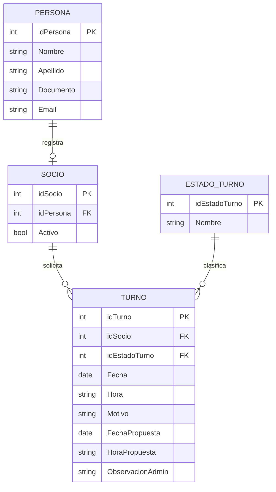

# Proceso de turnos presenciales

Este documento resume como el modulo de turnos cumple los criterios de calidad pedidos para la defensa.

## Flujo funcional

1. El socio entra a `/socio/turnos`.
2. En la misma pagina ve sus turnos, con busqueda, filtros, paginacion y detalle en modal.
3. Para pedir un turno nuevo abre el modal de solicitud desde esa misma pagina.
4. El modal carga disponibilidad con `GET /turnos/disponibilidad`.
5. El socio selecciona dia, horario y motivo.
6. El formulario valida que el horario sea valido, que no sea pasado, que no sea fin de semana y que el detalle tenga entre 10 y 300 caracteres.
7. Se crea el turno con `POST /turnos` en estado `Pendiente`.
8. El administrador entra a `/admin/turnos`, ve todos los turnos y puede aprobar, proponer otro horario o rechazar.
9. Las acciones del administrador actualizan el estado con `PUT /admin/turnos/:id`.
10. Si el administrador propone otro horario, el socio puede aceptarlo con `PUT /turnos/:id/aceptar-propuesta`.

## Endpoints usados

| Accion | Metodo | Endpoint | Archivo |
| --- | --- | --- | --- |
| Consultar disponibilidad | GET | `/turnos/disponibilidad?desde=YYYY-MM-DD&dias=N` | `src/hooks/useTurnos.jsx` |
| Crear turno | POST | `/turnos` | `src/hooks/useTurnos.jsx` |
| Listar turnos de un socio | GET | `/turnos/socio/:idSocio` | `src/hooks/useTurnos.jsx` |
| Aceptar propuesta | PUT | `/turnos/:id/aceptar-propuesta` | `src/hooks/useTurnos.jsx` |
| Listar turnos de admin | GET | `/admin/turnos` | `src/hooks/useAdminTurnos.jsx` |
| Actualizar estado | PUT | `/admin/turnos/:id` | `src/hooks/useAdminTurnos.jsx` |

> El modulo de turnos no elimina registros fisicamente desde la interfaz. Los turnos se cierran por estado (`Rechazado`, `Cancelado`, `Aceptado`) para conservar trazabilidad.

## Modelo entidad-relacion esperado

## Estados

| Id | Estado | Uso |
| --- | --- | --- |
| 1 | Pendiente | Turno recien solicitado por el socio |
| 2 | Aprobado | Admin aprueba la fecha solicitada |
| 3 | Propuesto | Admin propone otro dia y horario |
| 4 | Rechazado | Admin rechaza con motivo |
| 5 | Cancelado | Turno cerrado sin concretarse |
| 6 | Aceptado | Socio acepta la propuesta del admin |

## Seguridad y validaciones

- El frontend envia token JWT en el header `Authorization`.
- Las rutas estan protegidas por rol: socio y admin tienen pantallas separadas.
- Los formularios validan campos obligatorios antes de enviar.
- El motivo del turno se sanitiza quitando caracteres peligrosos como `<` y `>`.
- El detalle del socio y las observaciones del admin tienen limite de 300 caracteres.
- React escapa automaticamente los textos renderizados, ayudando contra XSS.
- La proteccion real contra SQL Injection debe estar en el backend usando consultas parametrizadas o Entity Framework.
- CSRF se reduce al trabajar con JWT en header en lugar de cookies de sesion tradicionales.

## Rubrica

| Categoria | Como se demuestra en turnos |
| --- | --- |
| Acceso y gestion de datos | `fetch` con GET, POST y PUT, `async/await`, manejo de errores y fallback local |
| Arquitectura del proyecto | Rutas en `App.jsx`, paginas separadas, hooks de API, utilidades compartidas y store local |
| Base de datos | Modelo documentado con `Socio`, `Turno` y `EstadoTurno`, claves y relaciones |
| Seguridad | Token, roles, validaciones, sanitizacion y mensajes de error controlados |
| Calidad del codigo | Funciones descriptivas, helpers reutilizables y separacion entre UI, API y utils |
| UX/UI | Busqueda, filtros, paginacion, modales, confirmaciones y toasts |
| Documentacion | Este documento explica endpoints, flujo, estados y modelo |
| Manejo del estado | `useState`, `useEffect`, `useMemo`, estado global para auth/notificaciones y recarga controlada |
